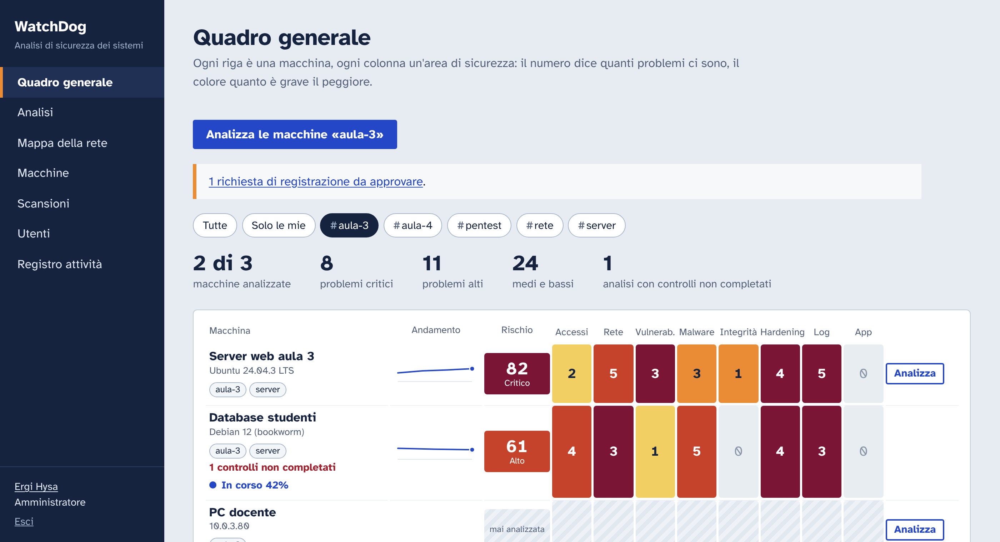

# WatchDog Web

Applicazione web multi-utente per la **valutazione del rischio di sicurezza** di sistemi Linux
e macOS. Più persone avviano scansioni dal browser, i risultati restano in un database
PostgreSQL e si confrontano nel tempo. Gira interamente in **Docker** (web, worker, database e
proxy HTTPS), anche su un Raspberry Pi 4/5 a 64 bit.

Sotto, l'applicazione usa lo stesso motore di scansione della versione a riga di comando
(`risk_assessor`, incluso in questo repository in `src/`): controlli, punteggi e report sono
identici. L'interfaccia web aggiunge gli account, il database, la coda delle scansioni, i
grafici e l'API.



*Il quadro generale (heatmap macchine × aree di sicurezza) con dati di esempio.*

---

## Indice

- [Avvio rapido](#avvio-rapido)
- [Dipendenze](#dipendenze)
- [Come provare l'applicazione](#come-provare-lapplicazione)
- [Funzionalità](#funzionalità)
- [Struttura del repository](#struttura-del-repository)
- [Sicurezza (hardening)](#sicurezza-hardening)
- [Sviluppo e test](#sviluppo-e-test)
- [Sviluppi futuri](#sviluppi-futuri)
- [Riferimenti](#riferimenti)

---

## Avvio rapido

Serve solo **Docker** (su Windows/macOS: Docker Desktop, che deve restare aperto). Tutto il
resto — Python, PostgreSQL, le librerie — sta dentro le immagini: non si installa nient'altro.

```sh
# 1. Clona il repository
git clone https://github.com/ErgiHysa24/Web_App.git
cd Web_App/webapp

# 2. Crea il file .env (chiavi casuali e indirizzi di questo computer per il certificato HTTPS)
python3 setup_env.py                 # su Windows: python setup_env.py

# 3. Costruisci e avvia tutti i servizi
docker compose up -d --build

# 4. Crea il primo amministratore (chiede una password di almeno 12 caratteri)
docker compose exec web watchdog-web create-admin
```

Apri **`https://localhost:8443`**. Al primo accesso:

1. il browser avvisa che il certificato non è riconosciuto: è **normale**, il certificato è
   firmato da un'autorità creata dal tuo WatchDog, non da un ente pubblico. Procedi
   («Avanzate → Procedi»); per togliere l'avviso vedi `webapp/README.md` → *Certificato*;
2. l'amministratore attiva la **verifica in due passaggi**: inquadra il QR con un'app come
   Google Authenticator, Microsoft Authenticator, Aegis o FreeOTP, e inserisci il codice.

> **Nota.** `python3 setup_env.py` serve solo a generare il file `.env` con chiavi casuali: ha
> bisogno di Python 3 sul tuo computer (di solito già presente su Linux/macOS). In alternativa
> puoi copiare `webapp/.env.example` in `webapp/.env` e compilare a mano `WATCHDOG_SECRET_KEY` e
> `POSTGRES_PASSWORD` con due stringhe casuali.

Comandi utili, dalla cartella `webapp/`:

| Cosa | Comando |
| --- | --- |
| Stato dei servizi | `docker compose ps` |
| Log delle scansioni | `docker compose logs -f worker` |
| Fermare / riavviare | `docker compose down` / `docker compose up -d` |
| Password dimenticata | `docker compose exec web watchdog-web reset-password <utente>` |
| 2FA persa | `docker compose exec web watchdog-web reset-2fa <utente>` |
| Backup del database | `docker compose exec db pg_dump -U watchdog watchdog > backup.sql` |

I dati stanno in volumi Docker e sopravvivono a ricostruzioni e aggiornamenti;
`docker compose down -v` li cancella.

## Dipendenze

- **Docker** 24+ e **Docker Compose** v2 (o Docker Desktop su Windows/macOS). È l'unico
  requisito per far girare l'applicazione.
- **Python 3** sul computer host **solo** per lo script `setup_env.py` (facoltativo: vedi la
  nota sopra per crearlo a mano).

Dentro le immagini, bloccate con hash in `requirements.txt` e `webapp/requirements.txt`:
FastAPI/Starlette, SQLAlchemy 2, psycopg 3 (PostgreSQL 16), Jinja2, uvicorn, cryptography
(cifratura delle credenziali e TOTP), segno (QR code), paramiko (SSH, nel worker). Il proxy è
**Caddy 2.10**, il database **PostgreSQL 16**.

## Come provare l'applicazione

Cosa puoi vedere subito, **senza altri sistemi** (copre login/logout, data entry, database):

1. **Accedi** come amministratore (passo 4 dell'avvio) e attiva la 2FA.
2. **Macchine → Aggiungi macchina**: inserisci un nome, un indirizzo (per esempio
   `192.168.1.50`), un utente SSH e una password. È un inserimento di dati: la macchina viene
   salvata nel database (le credenziali **cifrate**) e la puoi modificare o eliminare. I **tag**
   (es. `aula-3, linux`) servono a filtrare e raggruppare.
3. **Utenti**: crea altri utenti o approva le registrazioni, assegnando i ruoli.
4. **Profilo → Token per l'API**: crea un token e prova l'[API REST](webapp/README.md#api).

Per **eseguire davvero una scansione** serve un sistema **raggiungibile via SSH** e dentro una
rete privata consentita (`WATCHDOG_ALLOWED_NETWORKS`, di default `10.0.0.0/8`, `172.16.0.0/12`,
`192.168.0.0/16`): per esempio una VM Linux con SSH attivo, o un altro computer della tua rete.
Indirizzi pubblici, il server stesso e gli indirizzi link-local vengono **rifiutati** di
proposito (vedi [Sicurezza](#sicurezza-hardening)). Poi: **Nuova scansione → scegli la macchina
e il tipo** (*Controlli nativi* è il più rapido, ~1 minuto, non installa nulla). L'avanzamento
si vede dal vivo e alla fine apri il report.

> Usa WatchDog solo su sistemi che sei **autorizzato** ad analizzare.

Esempi di report generati dal motore sono in [`esempi/`](esempi/).

## Funzionalità

- **Login / logout** con sessione sicura e **verifica in due passaggi** (TOTP).
- **Registrazione** con 2FA e **approvazione** di un amministratore; ruoli *solo lettura*,
  *analista*, *amministratore*.
- **Data entry e modifica** dei modelli: macchine (obiettivi), tag, condivisioni, utenti,
  token API — tutto salvato in **PostgreSQL** via SQLAlchemy.
- **Scansioni in coda ed eseguite in parallelo** da un worker separato; avanzamento dal vivo,
  annullamento, storico e **confronto** tra scansioni (nuovo / risolto / non ricontrollato).
- **Grafici** disegnati dal server (SVG, nessuna libreria esterna): heatmap, analisi per
  gravità e area, **mappa della rete** con le porte aperte, andamento nel tempo.
- **Report completo** (HTML, JSON, Markdown) per ogni scansione.
- **API REST** con token a scadenza, di sola lettura per default.
- Una scansione che non si collega o non completa dei controlli **lo dichiara**: non viene mai
  mostrata come «nessun problema».

Dettaglio completo d'uso in **[`webapp/README.md`](webapp/README.md)**; la relazione tecnica in
**[`RELAZIONE.md`](RELAZIONE.md)**.

## Struttura del repository

```
Web_App/
├── README.md               questo file
├── RELAZIONE.md            relazione tecnica dell'applicazione web
├── docs/                   screenshot e materiale
├── esempi/                 report di esempio prodotti dal motore
├── pyproject.toml          il motore WatchDog (risk_assessor)…
├── requirements.txt        …con le sue dipendenze bloccate con hash
├── src/risk_assessor/      codice del motore di scansione (usato dalla web app)
└── webapp/                 l'applicazione web
    ├── docker-compose.yml  proxy + web + worker + database
    ├── Dockerfile          immagine unica per web e worker
    ├── proxy/Caddyfile     configurazione HTTPS
    ├── setup_env.py        crea il file .env
    ├── watchdog_web/       codice dell'app (FastAPI): viste, API, modelli, sicurezza
    ├── tests/              85 test
    ├── README.md           guida d'uso completa
    └── REVISIONE-SICUREZZA.md   revisione di sicurezza
```

Il motore (`src/`) è incluso perché la web app lo usa per eseguire le scansioni: così il
repository **funziona interamente con `git clone` + i comandi dell'avvio rapido**, senza
dipendenze esterne da scaricare a parte.

## Sicurezza (hardening)

Progettata per essere esposta in rete locale. In breve (dettaglio in
[`webapp/README.md`](webapp/README.md#sicurezza) e in
[`webapp/REVISIONE-SICUREZZA.md`](webapp/REVISIONE-SICUREZZA.md)):

- **Accesso**: solo HTTPS (TLS 1.2+, HSTS), cookie `__Host-` con `Secure`/`HttpOnly`/`SameSite`,
  password con scrypt (≥12 caratteri), 2FA TOTP, blocco dopo tentativi falliti, scadenza sessione.
- **Dati**: credenziali SSH degli obiettivi **cifrate** (Fernet); token API salvati come hash;
  registro delle attività.
- **Pagine**: token CSRF + controllo Origin, Content-Security-Policy senza inline né risorse
  esterne, `frame-ancestors 'none'`, output dei sistemi analizzati trattato come non fidato,
  limite di dimensione delle richieste.
- **Obiettivi**: solo reti private consentite; mai il server stesso, i link-local
  (`169.254.169.254`) o i servizi interni — difesa contro gli **SSRF**; chiave host SSH fissata
  alla prima connessione.
- **Container**: dall'esterno si raggiunge **solo il proxy**; web e database senza porte
  pubblicate su reti interne **senza uscita**; file system in **sola lettura**, `cap_drop: ALL`,
  `no-new-privileges`, utente non privilegiato, limiti di memoria e processi.
- **Catena di fornitura**: dipendenze bloccate con hash; in sviluppo `bandit` e `pip-audit`.

La revisione di sicurezza è stata verificata anche con uno strumento di pentest attivo
(`watchdog-pentest`): l'applicazione la supera **senza alcun finding** sui 16 moduli.

## Sviluppo e test

```sh
cd webapp
python -m venv .venv && . .venv/bin/activate     # Windows: .venv\Scripts\activate
pip install -e .. -e ".[test]"                   # .. è il motore, . è la web app
python -m pytest                                 # 85 test (SQLite)
```

In sviluppo, senza Docker, si può avviare l'app con SQLite e 2FA disattivata
(`WATCHDOG_REQUIRE_2FA=none`): vedi [`webapp/README.md`](webapp/README.md#sviluppo).

## Sviluppi futuri

- **Notifiche** (email o webhook) quando una scansione trova problemi critici o cambia il rischio.
- **Scansioni programmate** (per esempio ogni notte) con confronto automatico.
- **Esportazione** del quadro generale in PDF e invio periodico via email.
- **Single Sign-On** (OIDC) per le organizzazioni che già hanno un identity provider.
- **Grafici storici** su finestre più lunghe e per gruppi di macchine (tag).
- Integrazione con un servizio di **arricchimento CVE** (per esempio EPSS) per pesare il rischio
  anche sulla sfruttabilità reale.

## Riferimenti

- [OWASP Top 10](https://owasp.org/www-project-top-ten/) e
  [OWASP ASVS](https://owasp.org/www-project-application-security-verification-standard/) —
  criteri di sicurezza delle applicazioni web seguiti nel progetto.
- [OWASP Cheat Sheet Series](https://cheatsheetseries.owasp.org/) — sessioni, CSRF, password,
  intestazioni di sicurezza.
- [FastAPI](https://fastapi.tiangolo.com/) · [Starlette](https://www.starlette.io/) ·
  [SQLAlchemy 2](https://docs.sqlalchemy.org/en/20/) — framework e ORM usati.
- [Caddy](https://caddyserver.com/docs/) — proxy e HTTPS automatico.
- [Docker — build e compose](https://docs.docker.com/) ·
  [Docker security](https://docs.docker.com/engine/security/) — contenitori e hardening.
- [RFC 6238 (TOTP)](https://datatracker.ietf.org/doc/html/rfc6238) — verifica in due passaggi.
- [MDN — HTTP security headers](https://developer.mozilla.org/en-US/docs/Web/HTTP/Headers) ·
  [CSP](https://developer.mozilla.org/en-US/docs/Web/HTTP/CSP).
- [PostgreSQL 16](https://www.postgresql.org/docs/16/) — database.

---

**Autore:** Ergi Hysa · **Anno accademico:** 2025–2026 · Licenza [MIT](LICENSE).
