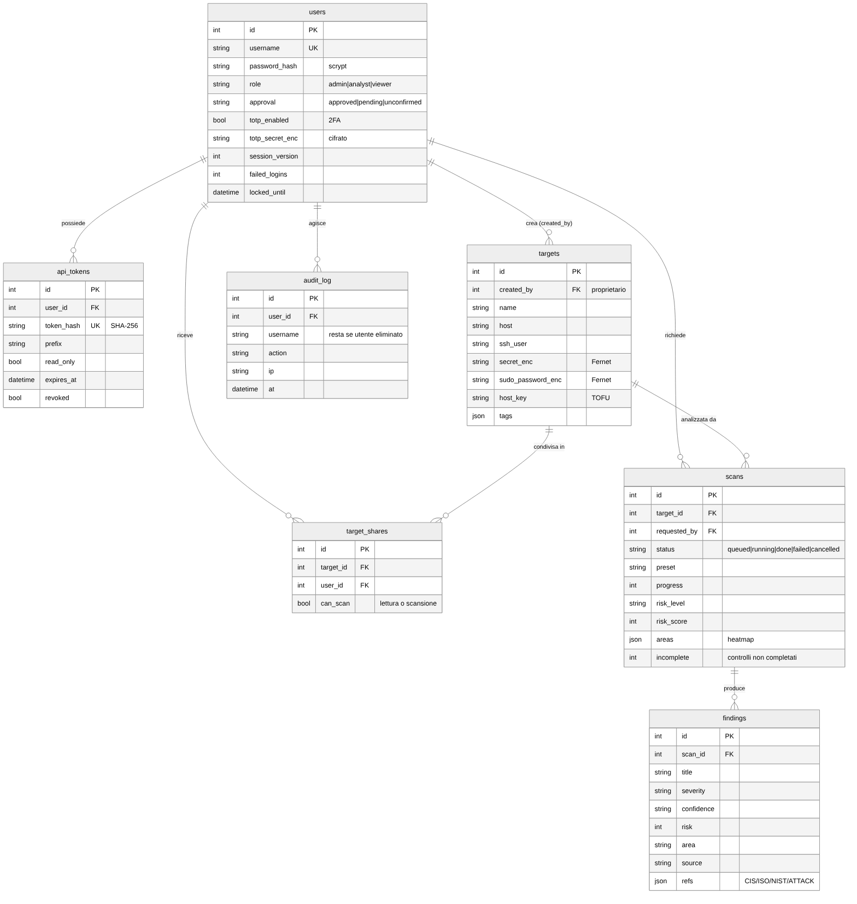
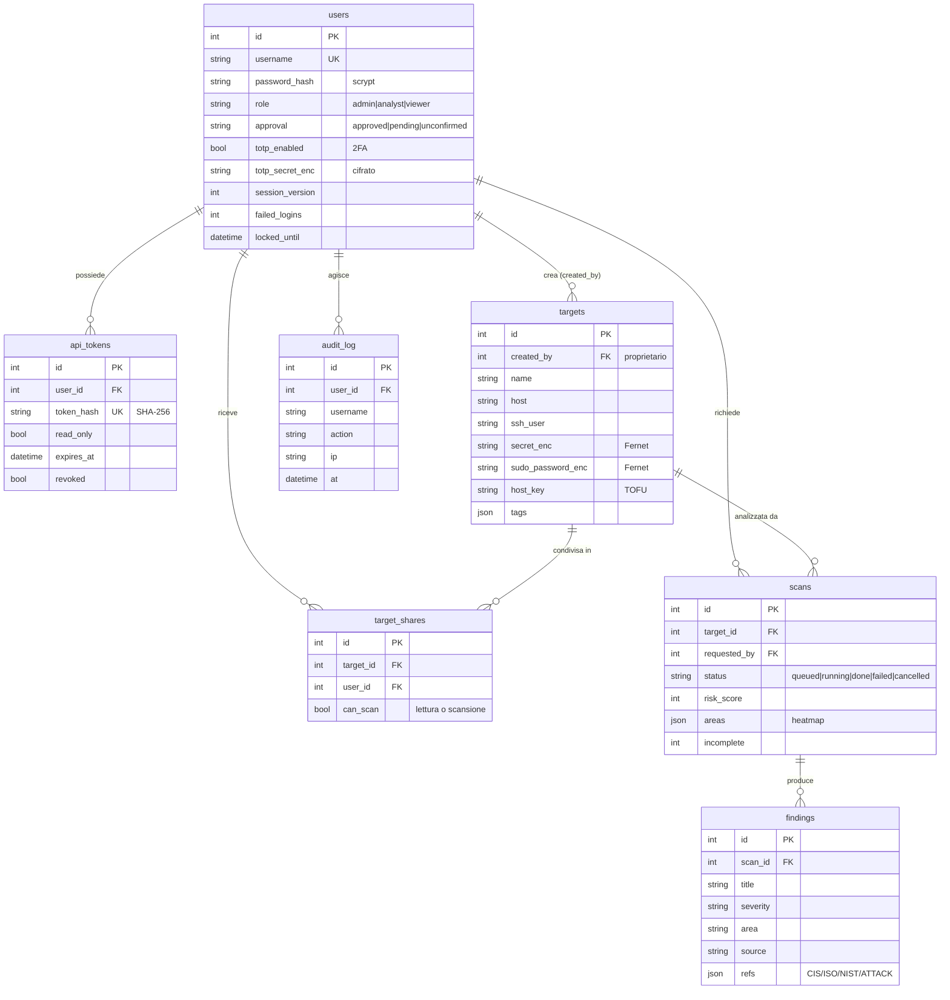

# Schema del database

WatchDog Web usa **PostgreSQL 16** (in sviluppo anche SQLite). Sette tabelle; le chiavi esterne
hanno `ON DELETE CASCADE` dove la riga figlia non ha senso senza il padre (i token di un utente,
i finding di una scansione) e `ON DELETE SET NULL` dove la storia va conservata anche se l'autore
sparisce (chi ha creato una macchina, chi ha richiesto una scansione, il registro attività).

## Le tabelle

| Tabella | A cosa serve | Note di sicurezza |
|---|---|---|
| **users** | account, ruolo, stato di approvazione, 2FA | password con **scrypt**; segreto TOTP **cifrato**; `session_version` invalida le sessioni al cambio password; `failed_logins`/`locked_until` per il blocco anti brute-force |
| **api_tokens** | token personali per l'API | salvato solo l'**hash SHA-256**; `read_only` e `expires_at`; revocabile |
| **targets** | le macchine da analizzare | password e chiavi SSH **cifrate** (Fernet); `host_key` fissata alla prima connessione (TOFU); `created_by` = proprietario |
| **target_shares** | condivisione di una macchina con un altro utente | vincolo di unicità `(target_id, user_id)`; `can_scan` distingue sola lettura da scansione |
| **scans** | ogni scansione **ed è anche la coda** dei lavori | indice unico parziale: una sola scansione `running` per obiettivo; il worker prende la riga con `FOR UPDATE SKIP LOCKED` |
| **findings** | i risultati, una riga per problema | collegati a CIS/ISO 27001/NIST/ATT&CK in `refs` |
| **audit_log** | chi ha fatto cosa e quando | `username` resta anche se l'utente viene eliminato (`SET NULL` sulla FK) |

Le colonne `tags`, `options`, `areas`, `counts`, `summary`, `refs` sono **JSON** (`JSONB` su
PostgreSQL). Lo schema viene creato all'avvio dai modelli SQLAlchemy in
[`webapp/watchdog_web/models.py`](../webapp/watchdog_web/models.py).
